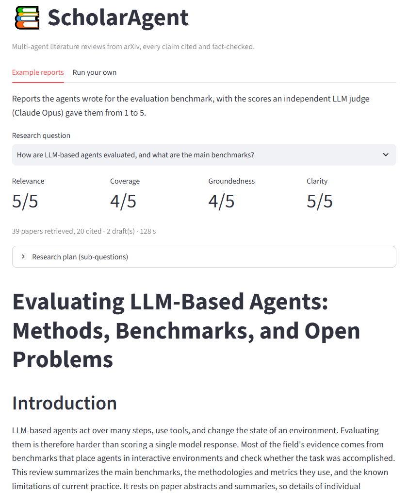
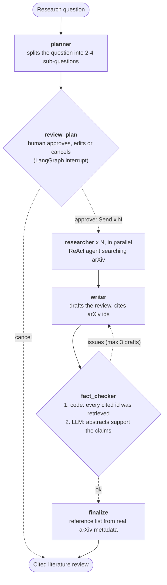

# ScholarAgent

[](https://github.com/Ytikare/agentic_scholar_researcher/actions/workflows/ci.yml)

**A multi-agent research assistant that turns a research question into a cited, fact-checked
literature review from arXiv papers.**

**[Live demo](https://scholar-ui-dkc3.onrender.com/)**: example reports are free to browse; live runs need an access
password (each one spends real API credits). The free server may take ~1 minute to wake up.



## Results

| Result | How |
|---|---|
| **0 made-up citations** across the benchmark | Every cited arXiv id is checked in code against the papers actually retrieved, and the reference list is built from real arXiv metadata, not written by the LLM. |
| **Coverage 3.25 → 4.0 / 5** (LLM judge) | Experiment 1 made researchers look up foundational papers by title first: better on 6 of 8 questions, worse on none, and a judge-noise study confirmed the gain is real ([details](evals/experiments.md)). |
| **~$0.20 per report** | Per-node cost tracking showed 95% of the cost is the writer and fact-checker, not the research; a budget cap stops runaway runs. |
| **43 offline tests, CI on every push** | Fake LLMs and a fake arXiv: no API key, no network, no cost. CI also builds and smoke-tests the Docker image. |

**Built with:** LangGraph · Claude (Haiku 5.5 researches, Sonnet 5.5 writes and fact-checks,
Opus 5.5 judges evals) · FastAPI · Streamlit · SQLite checkpoints · LangSmith · Docker ·
GitHub Actions · Render

## How it works



- **Planner** splits the question into 2–4 sub-questions (structured output).
- **Researchers** run in parallel, each a small tool-using agent that searches arXiv and writes cited notes.
- **Writer** drafts the review, citing papers inline by arXiv id.
- **Fact-checker** verifies citations twice: in code (every cited id must be a retrieved paper,
  so made-up papers can't get through) and with an LLM (does the cited abstract support the claim?).
- **Finalize** builds the reference list from real arXiv metadata, so references can't be made up.

## Design decisions

**A graph of small agents, not one big agent.** Each sub-question gets its own researcher,
so research runs in parallel and every agent works with a small, focused context. Each step
can also be tested and measured on its own. The cost is more LLM calls and orchestration
code, which LangGraph keeps manageable.

**Researchers see only their sub-question; reducers merge their results.** `Send` hands each
researcher just `{"sub_question": ...}`. Their `findings` and `papers` are combined by
reducers (`operator.add`, `merge_papers`), because without one, parallel writes to the same
state key are rejected.

**Code checks what code can check; the LLM checks the rest.** Whether a cited arXiv id was
really retrieved is a set lookup, so it is done in code and never misses a made-up paper.
Only the judgment call (does this abstract support this claim?) goes to an LLM. For the same
reason, the reference list is rendered from arXiv metadata instead of written by the model.

**A model per job.** Haiku 5.5 handles the many research calls cheaply, Sonnet 5.5 writes and
fact-checks, and evals are graded by Opus 5.5: a different, stronger model than the writer,
so the judge isn't grading its own style. Cost tracking backs this up: the researchers make
most of the calls but account for ~4% of the cost.

**Every loop has a limit.** The revision loop stops after 3 drafts (left-over issues are
listed in the report instead of hidden), each researcher has a step limit (hitting it keeps
the papers found so far and says so), and every run has a dollar budget.

**Ask the human before spending money.** The run pauses for plan approval after the cheap
planning step and before the expensive research. Because LangGraph re-runs an interrupted
node from its first line on resume, nothing with side effects comes before `interrupt()`.

**Checkpoint every step.** A SQLite checkpointer saves state after each step, including the
results of parallel researchers that finished before a crash, so resuming only re-runs the
work that failed. The CLI and the API share the database, so either can resume the other's
runs.

**Tests that cost nothing.** Every node is built by a factory that takes its LLM as an
argument, so tests inject fake LLMs. The fakes choose replies by reading the request, not by
call order, because parallel researchers call them in unpredictable order. The whole suite
runs offline in seconds, which is what makes CI on every push free.

**Measure before claiming.** Changes are judged on a fixed benchmark with code metrics and an
LLM judge, and the judge's own noise was measured: a single grading pass can move a
benchmark average by up to 0.5, so only effects larger than that are reported as real.

**Background runs with polling, not long requests.** A run takes minutes, so `POST /runs`
returns at once and clients poll for status. This is simple and works with Streamlit and
free hosting; the trade-off is that live run progress is kept in one server's memory.

## Quickstart

```bash
uv sync
cp .env.example .env      # then put your ANTHROPIC_API_KEY in .env
uv run scholar "What are current approaches to reducing hallucination in RAG?"
```

The run pauses after planning so you can **approve, edit or cancel** the sub-questions before
any research is done. Every step is saved to a SQLite checkpoint, so a stopped or crashed run
continues where it left off:

```bash
uv run scholar -y "question"          # auto-approve the plan
uv run scholar --resume <run-id>      # continue a paused or crashed run
```

## Web app and API

A FastAPI backend runs the agents; a Streamlit page is a thin client on top of it.

```bash
uv sync --extra ui
uv run scholar-api        # API on http://localhost:8000 (interactive docs at /docs)
uv run scholar-ui         # web page on http://localhost:8501
```

| Endpoint | What it does |
|---|---|
| `POST /runs` | start a run: `{"question": "...", "auto_approve": false}` -> `202` with a `run_id` |
| `GET /runs/{run_id}` | status (`running`, `awaiting_approval`, `done`, `cancelled`, `failed`, `stopped`), progress events, plan, report, cost |
| `POST /runs/{run_id}/decision` | answer the plan review: `{"action": "approve" \| "edit" \| "cancel", "sub_questions": [...]}` |
| `GET /health` | liveness check |

A run takes minutes, so `POST /runs` returns at once and the run continues in a background
thread; clients poll `GET /runs/{id}`. The plan review is the same LangGraph `interrupt()`
the CLI uses, and runs live in the same SQLite checkpoint database, so a run started in the
browser can be resumed with `uv run scholar --resume <run_id>`.

Because every run spends money on your API key, the API has three guards: an optional
bearer token (`API_TOKEN`; the UI sends `SCHOLAR_API_TOKEN`), the per-run cost budget, and
a cap on simultaneous runs (`MAX_CONCURRENT_RUNS`, default 2).

## Docker

One image runs either service; `docker compose` starts both, with run checkpoints kept in a
volume:

```bash
docker compose up --build    # UI on http://localhost:8501, API on http://localhost:8000
```

The image installs from `uv.lock` (so it gets exactly the tested versions), runs as a non-root
user, and keeps dependencies in their own layer so code changes rebuild in seconds.

## Deployment (Render)

`render.yaml` deploys the API and the UI as two free Render web services built from the
same Dockerfile. The public page shows **example reports** (bundled, free, always available);
**live runs need an access password**, because each one spends real API credits.

1. Render dashboard -> **New -> Blueprint** -> select this repo.
2. Fill in the secrets it asks for: `ANTHROPIC_API_KEY`, and `API_TOKEN` (the access
   password you give out). Leave `SCHOLAR_API_URL` for now if you don't know it yet.
3. Once `scholar-api` is live, copy its URL (`https://scholar-api-xxxx.onrender.com`) into
   `SCHOLAR_API_URL` on `scholar-ui` and redeploy the UI.

Free-tier trade-offs: services sleep after 15 idle minutes (the first request then takes
~1 minute), and the filesystem is temporary, so saved runs disappear on restart. Each run is
capped at $0.50 and only one runs at a time.

## Continuous integration

Every push and pull request runs `.github/workflows/ci.yml` on GitHub:

1. **Lint and test:** ruff and the full offline test suite (fake LLMs, fake arXiv: no API key,
   no network, no cost).
2. **Docker:** builds the image, then starts the API and the UI from it and checks that both
   answer their health endpoints.

## Cost and tracing

Every run prints what it cost, per node and per model, from the token counts the API
reports and Anthropic's per-token prices (`src/scholar_agent/costs.py`):

```
Cost: $0.219 over 17 LLM calls
fact_checker  0.0999      claude-haiku-5-5:  68,337 in / 5,941 out = $0.0098
planner       0.0001      claude-sonnet-5-5: 60,740 in / 8,805 out = $0.2095
researcher    0.0097
writer        0.1096
```

The cheap Haiku researchers do most of the calls but cost ~4%; the Sonnet writer and
fact-checker cost ~95%, and each extra revision round adds ~$0.07. So the revision loop,
not the research, is what to optimize.

A **budget** stops a run once it has cost more than `MAX_COST_USD` (default $1, about 5x a
normal run) or `--max-cost`. Finished steps are checkpointed, so a stopped run can be
resumed with a higher limit. `scholar-eval` records agent and judge cost separately and
takes `--max-total` for the whole benchmark.

**Tracing:** set `LANGSMITH_TRACING=true`, `LANGSMITH_API_KEY` and `LANGSMITH_PROJECT` in
`.env` (see `.env.example`) and every run shows up in LangSmith as a tree of nodes, LLM
calls and tool calls, with inputs, outputs, tokens and latency. Runs are tagged with
their run id.

## Tests

```bash
uv run pytest             # offline unit tests (fake LLM, fake arXiv)
uv run pytest -m live     # tests that hit real APIs
uv run ruff check .       # lint
```

## Evals

Unit tests check that the code works; evals check that the **reports are good**.
`evals/questions.json` is a small benchmark of research questions across ML subfields.

```bash
uv run scholar-eval                  # run every question, score each report
uv run scholar-eval --limit 2        # quick smoke run
uv run scholar-consistency evals/results/<run>/<id>.json -n 5
```

Each report is scored two ways:

| Kind | Metric | What it tells you |
|---|---|---|
| Code | `citation_coverage` | share of sentences that cite a paper (strict: one citation per paragraph scores low) |
| Code | `unknown_citations` / `citation_precision` | made-up citations, should always be 0 / 1.0 |
| Code | `drafts_written`, `unresolved_issues` | how much revising the fact-checker forced |
| LLM judge | relevance, coverage, groundedness, clarity (1–5) | quality a researcher would care about; graded by a different, stronger model (`JUDGE_MODEL`) with written reasoning |

Plus latency and tokens per model for every run. `scholar-consistency` re-runs the
fact-checker on one saved draft and reports how often its verdicts agree, because a
checker that flags different things on each run can't be trusted to drive revisions.

Results and experiments so far: [evals/experiments.md](evals/experiments.md).

## Roadmap

- [x] Phase 0: project setup (uv, ruff, pytest)
- [x] Phase 1: single ReAct agent with an arXiv tool
- [x] Phase 2: multi-agent graph (planner → parallel researchers → writer → fact-checker)
- [x] Phase 3: human-in-the-loop + checkpointing
- [x] Phase 4–5: tests + LLM-as-judge evals
- [x] Phase 6: tracing & cost tracking
- [x] Phase 7: FastAPI + Streamlit
- [ ] Phase 8: Docker, CI, deploy
